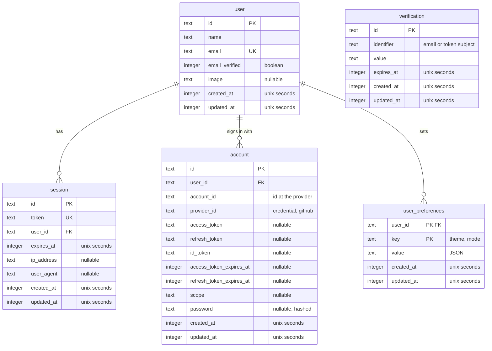

# Database schema

Everything the app stores lives in one Cloudflare D1 database, `autobourdain`
(SQLite). [`schema.ts`](schema.ts) is the source of truth. This page explains
it, and is updated in the same change as any edit to that file.

There are two kinds of table:

- **Auth tables** - `user`, `session`, `account`, `verification`. Owned by
  better-auth, which reads and writes them through its Drizzle adapter.
- **Application tables** - everything else, owned by this app's own routes.

## Diagram



The diagram uses SQL column names, which is what D1 holds. The tables below
also give the Drizzle property for each, which is the name code uses.

Every table hanging off `user` deletes with it (`ON DELETE CASCADE`).
`verification` stands alone on purpose: its rows are matched by `identifier`,
not by a foreign key.

Timestamps are `integer` Unix seconds, read as `Date` through Drizzle's
`timestamp` mode. Booleans are `integer` 0/1.

## Auth tables

Owned by better-auth. Two rules hold for all four:

- **Never rename a property.** The Drizzle adapter looks fields up by the
  _property_ name, not the SQL column - rename one and better-auth stops
  finding it.
- **Regenerate rather than hand-edit** after a better-auth upgrade:
  `npx @better-auth/cli generate` prints the reference schema.

### `user`

One row per person.

| Column           | Property        | Type    | Null | Default     | Meaning                         |
| ---------------- | --------------- | ------- | ---- | ----------- | ------------------------------- |
| `id`             | `id`            | text    | no   |             | Primary key, set by better-auth |
| `name`           | `name`          | text    | no   |             | Display name                    |
| `email`          | `email`         | text    | no   |             | Unique                          |
| `email_verified` | `emailVerified` | integer | no   | `false`     | Boolean                         |
| `image`          | `image`         | text    | yes  |             | Avatar URL, from GitHub         |
| `created_at`     | `createdAt`     | integer | no   | `unixepoch` |                                 |
| `updated_at`     | `updatedAt`     | integer | no   | `unixepoch` |                                 |

### `session`

One row per signed-in device. The token is what the cookie, or the native
app's `Authorization` header, carries.

| Column       | Property    | Type    | Null | Default     | Meaning                       |
| ------------ | ----------- | ------- | ---- | ----------- | ----------------------------- |
| `id`         | `id`        | text    | no   |             | Primary key                   |
| `expires_at` | `expiresAt` | integer | no   |             |                               |
| `token`      | `token`     | text    | no   |             | Unique                        |
| `ip_address` | `ipAddress` | text    | yes  |             | From `cf-connecting-ip`       |
| `user_agent` | `userAgent` | text    | yes  |             |                               |
| `user_id`    | `userId`    | text    | no   |             | `user.id`, cascade on delete  |
| `created_at` | `createdAt` | integer | no   | `unixepoch` |                               |
| `updated_at` | `updatedAt` | integer | no   |             | Set by better-auth on refresh |

### `account`

One row per way a user signs in: `credential` for email and password,
`github` for GitHub.

| Column                     | Property                | Type    | Null | Default     | Meaning                       |
| -------------------------- | ----------------------- | ------- | ---- | ----------- | ----------------------------- |
| `id`                       | `id`                    | text    | no   |             | Primary key                   |
| `account_id`               | `accountId`             | text    | no   |             | The user's id at the provider |
| `provider_id`              | `providerId`            | text    | no   |             | `credential` or `github`      |
| `user_id`                  | `userId`                | text    | no   |             | `user.id`, cascade on delete  |
| `access_token`             | `accessToken`           | text    | yes  |             | OAuth only                    |
| `refresh_token`            | `refreshToken`          | text    | yes  |             | OAuth only                    |
| `id_token`                 | `idToken`               | text    | yes  |             | OAuth only                    |
| `access_token_expires_at`  | `accessTokenExpiresAt`  | integer | yes  |             | OAuth only                    |
| `refresh_token_expires_at` | `refreshTokenExpiresAt` | integer | yes  |             | OAuth only                    |
| `scope`                    | `scope`                 | text    | yes  |             | OAuth only                    |
| `password`                 | `password`              | text    | yes  |             | Hashed, `credential` only     |
| `created_at`               | `createdAt`             | integer | no   | `unixepoch` |                               |
| `updated_at`               | `updatedAt`             | integer | no   |             | Set by better-auth            |

### `verification`

Short-lived tokens: email verification and password reset.

| Column       | Property     | Type    | Null | Default     | Meaning                          |
| ------------ | ------------ | ------- | ---- | ----------- | -------------------------------- |
| `id`         | `id`         | text    | no   |             | Primary key                      |
| `identifier` | `identifier` | text    | no   |             | What the token is for, e.g. mail |
| `value`      | `value`      | text    | no   |             | The token                        |
| `expires_at` | `expiresAt`  | integer | no   |             |                                  |
| `created_at` | `createdAt`  | integer | no   | `unixepoch` |                                  |
| `updated_at` | `updatedAt`  | integer | no   | `unixepoch` |                                  |

## Application tables

### `user_preferences`

A user's preferences, one row per key. Read and written by
`GET` / `PATCH /api/preferences` ([`../preferences.ts`](../preferences.ts)).

| Column       | Property    | Type    | Null | Default     | Meaning                      |
| ------------ | ----------- | ------- | ---- | ----------- | ---------------------------- |
| `user_id`    | `userId`    | text    | no   |             | `user.id`, cascade on delete |
| `key`        | `key`       | text    | no   |             | The preference, e.g. `theme` |
| `value`      | `value`     | text    | no   |             | JSON-encoded value           |
| `created_at` | `createdAt` | integer | no   | `unixepoch` |                              |
| `updated_at` | `updatedAt` | integer | no   | `unixepoch` | Set on every upsert          |

Primary key: `(user_id, key)` - one value per key per user. `user_id` leads,
so the key doubles as the index for "all of this user's preferences".

**Key-value, on purpose.** A new preference is an entry in
`preferencesSchema` and `DEFAULT_PREFERENCES`
([`packages/shared/src/preferences.ts`](../../../../packages/shared/src/preferences.ts)),
with no migration. The cost is that SQLite knows nothing about the values -
they are opaque JSON, and cannot be filtered on in SQL.

**No row means the default.** A user only gets a row once they change a
setting, and `GET` folds whatever rows exist over the defaults. A default
changed later therefore reaches everyone who never picked.

**Zod is the only gate.** There is no CHECK constraint: `PATCH` validates
every key and value with `preferencesPatchSchema` before writing, and rejects
unknown keys and `null`. On read, a row whose key has been retired, or whose
value no longer fits - a removed theme, say - is skipped, and the default
stands in for it.

Current keys:

| Key     | Value                         | Default      |
| ------- | ----------------------------- | ------------ |
| `theme` | `cocoa-plum` \| `warm-ink`    | `cocoa-plum` |
| `mode`  | `light` \| `dark` \| `system` | `system`     |

## Changing the schema

Edit [`schema.ts`](schema.ts), update this page to match - the diagram
included - then:

```bash
npm run db:generate -w @autobourdain/api -- --name <what_changed>
npm run db:migrate         # apply locally
npm run db:migrate:remote  # apply to Cloudflare
```

Name every migration; without `--name`, drizzle-kit picks a random one. The
workspace form is deliberate - through the root `npm run db:generate`, npm
takes `--name` for itself and drizzle-kit never sees it.

Never hand-edit generated migrations - they are versioned with the code, and
`npm test` builds its database from the same files production does.

Remote migrations run before a deploy, never after: the code must not reach
production ahead of its schema.
